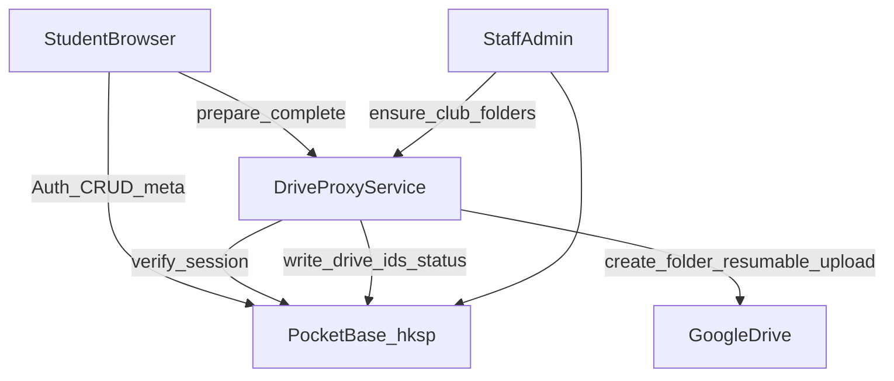

# HKSP 後端布局（PocketBase + Google Drive）

## 目標

- **結構化資料**（帳號、社團、綁定、分數、稽核、上傳狀態）：PocketBase `hksp_*`
- **實體檔案最終存放**：校方 Google Drive（持有帳 `hk_activity@hk.edu.tw`）
- **學生瀏覽器永不持有 Google token**（與 `privacy.html` 一致）

## 分層

| 層 | 職責 | 現況 |
|---|---|---|
| PocketBase | 身分、資格、資料夾樹 meta、上傳檔、分數 | **主路徑**：`hksp_*` + `file`（整夾／大檔） |
| Drive Proxy / GAS | 可選鏡射到校方 Drive | 已通測；預設 `useDriveProxy=false` |
| 前端 | 學生 `index.html`；評審 `judge.html`；管理 `admin.html` | 正式頁皆已接 PB（`judge-pb.html` 僅煙測） |

## 資料流（最終上傳）

1. 學生登入 PB → `getClubStudentAccessState` 確認活動／社團  
2. `prepare`：Proxy 向 Drive 建（或重用）上傳工作階段，回傳 **短效 uploadUrl**（或由 Proxy 代收再轉 Drive）  
3. 傳輸完成後 `complete`：Proxy 確認 Drive 檔案 → 寫入 `hksp_uploads.drive_file_id` / `status=completed`  
4. PB 上的暫存 `file` 可選：完成後清除（省空間）或保留作備援

## Drive 對應鍵

| PB 欄位 | 意義 |
|---|---|
| `hksp_activities.drive_root_folder_id` | 本活動 Drive 根資料夾 |
| `hksp_clubs.drive_folder_id` | 社團評選根資料夾 |
| `hksp_folders.drive_folder_id` | 子資料夾 |
| `hksp_uploads.drive_file_id` | 檔案 ID |
| `hksp_uploads.drive_web_view_link` | 開啟連結 |
| `hksp_drive_config` | 全域：持有帳、root、是否啟用代傳 |

## 安全邊界

- OAuth refresh token **只存在 Proxy 伺服器**（環境變數／密鑰庫），不上 PB 前端、不上 git  
- 授權帳必須核對為 `hk_activity@hk.edu.tw`  
- Proxy 每個請求先用 PB student token 驗證 membership + 上傳窗口  
- scope 實際為完整 Drive；「只寫活動樹」由 Proxy 路徑白名單強制

## 測試根資料夾（目前）

- Folder ID：`16G4v0Xrc7t0PjjOuor-68BokJXBGl6Jg`
- 連結：https://drive.google.com/drive/folders/16G4v0Xrc7t0PjjOuor-68BokJXBGl6Jg
- 已寫入：`hksp_drive_config.root_folder_id`、`hksp_activities.drive_root_folder_id`
- 狀態：測試持有帳 OAuth 已接通（`enabled=true` / proxy live）
- 目錄結構：`{root}/{activity_id}/{permanentClubId}_{clubName}/檔案`

## 階段

1. ~~布局 + 測試 root~~  
2. ~~持有帳 OAuth + proxy／GAS 真上傳~~（已通）  
3. ~~PB 改為上傳主路徑（無 GCP 計費也可整夾）~~  
4. ~~評審最小頁讀檔／打分（`judge-pb.html`）~~  
5. ~~完整 `judge.html`／`admin.html` 搬遷至 PocketBase~~  
6. **可選**：正式校方 Drive 持有帳鏡射（預設仍關閉）

## 不在本布局

- 讓學生 OAuth Google  
- 用 Drive 當帳號／分數資料庫  
